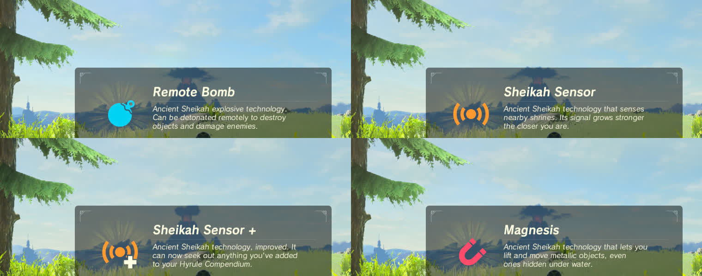
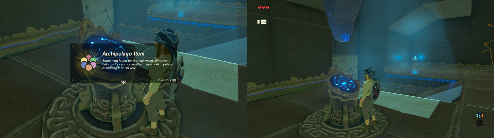
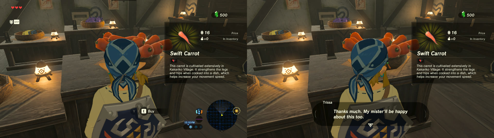
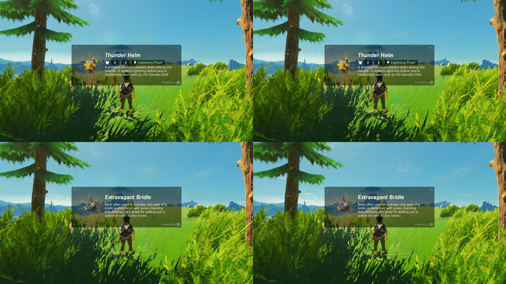
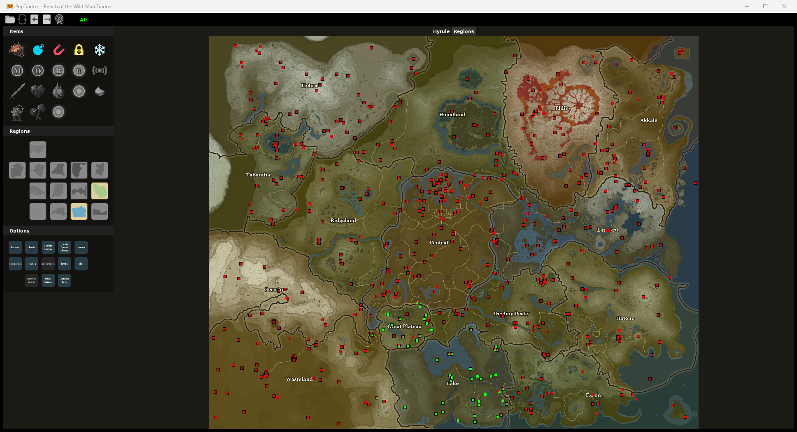

<div align="center">

# Breath of the Wild &times; Archipelago

**A multiworld randomizer for _The Legend of Zelda: Breath of the Wild_, running natively on the
[Savage Wind](https://github.com/Revivedx/SavageWindRecomp) PC recompilation.**


</div>

Shrines, Korok Seeds, chests, towers, memories, quests, Divine Beasts and shops all become checks, and nothing you
find is the game's own reward. What other players send you arrives **at once, with the game's own item-get scene**,
wherever Link is. The whole Archipelago client is built into the game: no extra window, no launcher.

---

## Contents
- [Features](#features)
- [What you need](#what-you-need)
- [Install](#install)
- [Play](#play)
- [Options](#options)
- [PopTracker](#poptracker)
- [Building from source](#building-from-source)
- [Notes](#notes)

---

## Features

<table>
<tr>
<td width="50%" valign="top">

### Native item delivery
Received items play the game's own item-get scene the moment they arrive, in the field, in shrines, in Divine
Beasts. Heart Containers and Stamina Vessels play their gauge scenes. Every check gives the **Archipelago Item**
instead of its normal reward, and it leaves the pouch on its own right after.

</td>
<td width="50%" valign="top">



</td>
</tr>
<tr>
<td valign="top">

### Progressive runes and champions
Remote Bomb, Stasis and the Sheikah Sensor come in two steps (the second is the **+**), Magnesis and Cryonis in
one. The four champion abilities are progressive too, with the Champions' Ballad **+**. The Great Plateau's rune
terminals and Purah's upgrades are checks of their own.

</td>
<td valign="top">



</td>
</tr>
<tr>
<td valign="top">

### Shop sanity
About 500 shop slots across Hyrule: town stores, armor shops, traveling merchants, Beedle at every stable, Kilton,
the tech labs. The first time you buy each thing a shopkeeper sells, its check goes out. You keep what you bought.

</td>
<td valign="top">



</td>
</tr>
<tr>
<td valign="top">

### Region lock
Hyrule opens region by region from the Great Plateau, one Sheikah Tower region per **Map** item. Walk toward a
locked region and the fog thickens; step in and it whites out, and Link is back where he last stood clear of it,
like the Lost Woods.

</td>
<td valign="top">


</td>
</tr>
<tr>
<td valign="top">

### Everything that was vanilla is in the pool
The Paraglider (you leave the plateau when it arrives), the Thunder Helm, Hestu's Maracas, the
**Progressive Master Sword** (4 with the DLC: the sword, then each Trial of the Sword's power), Hestu's Weapon / Bow /
Shield Slots, the minigame prizes, horse gear and more.

</td>
<td valign="top">



</td>
</tr>
</table>

**Also:** DeathLink, TrapLink (Thunderstorm and Midnight traps), RingLink, in-game notifications at the bottom left,
and "ARCHIPELAGO" under the logo on the title and loading screens.

---

## What you need

| | |
|---|---|
| **Game** | Your own dump of *Breath of the Wild* **1.9.0** for Switch (the Champions' Ballad is optional) |
| **Savage Wind Recomp** | **0.5.3-alpha.5**, built with [`savagewind-archipelago.patch`](savagewind-archipelago.patch) |
| **Archipelago** | **0.6.8** or later, to generate seeds and host |
| **Python** | 3.12 with `oead`, `evfl` and `Pillow`, to build the overlay from your own game files |

> [!IMPORTANT]
> This repository contains **no Nintendo files**. The overlay (changed game files) and the PopTracker pack are built
> on your machine from your own dump. They are yours alone: never share them.

---

## Install

1. **Savage Wind with the patch.** In a [Savage Wind](https://github.com/Revivedx/SavageWindRecomp) checkout at 0.5.3-alpha.5 (commit `740b180`):
   ```sh
   git apply savagewind-archipelago.patch
   make -j8
   ```
   then set up your game files as Savage Wind's own guide says.

2. **The apworld.** Copy [`botw.apworld`](botw.apworld) into Archipelago's `custom_worlds` folder.

3. **The overlay**, built once from your own game files:
   ```sh
   python -m venv .venv
   .venv/Scripts/python -m pip install oead evfl Pillow
   python -I tools/build_overlay.py "<your Savage Wind folder>"
   ```
   and add this line to `launch-flags.txt` next to `savagewind.exe`:
   ```
   SAVAGEWIND_ROMFS_OVERLAY=<your Savage Wind folder>/ap_overlay
   ```

---

## Play

1. Generate a seed with a YAML for **Breath of the Wild** (see [Options](#options)) and host it.
2. Start a **new game**.
3. **Options &rsaquo; Archipelago** (title screen, or pause menu &rsaquo; System &rsaquo; Options): enter the server,
   slot name and password, turn on the links you want, and press **Connect**.
4. Play. Checks go out the moment they happen; items arrive with their scenes.

The full guide is in [`worlds/botw/docs/setup_en.md`](worlds/botw/docs/setup_en.md).

---

## Options

| Option | Default | What it does |
|---|:---:|---|
| `required_champion_powers` | 4 | Champion abilities needed for defeating Calamity Ganon to count as your goal |
| `goal_needs_master_sword` | off | The goal also needs the Master Sword |
| `master_sword_hearts` | 10 | Heart Containers logic expects before pulling the Master Sword |
| `koroks` | on | The 900 Korok Seeds are checks |
| `chests` | on | Overworld chests are checks |
| `shrine_chests` | on | Chests inside shrines are checks |
| `divine_beast_chests` | on | Chests inside the Divine Beasts are checks |
| `towers` | on | Activating each Sheikah Tower is a check |
| `memories` | on | Each captured memory is a check |
| `quests` | on | Main, shrine and side quests are checks |
| `minigames` | off | Races, archery, Snowling bowling... are checks |
| `hestu` | on | Hestu's 35 pouch upgrades and his gift are checks (slots become items) |
| `dlc` | off | Champions' Ballad checks, the champions' **+** and 4 Master Swords (needs DLC 2) |
| `master_mode` | off | The 117 chests that only exist in Master Mode are checks |
| `shop_sanity` | off | Every shop slot in Hyrule is a check (about 500) |
| `region_lock` | off | Hyrule opens region by region with 14 Map items |
| `trap_percentage` | 5 | Share of filler that is a trap |

With the defaults a seed has **2,648** checks; with everything on, **3,339**.

```yaml
name: Link
game: Breath of the Wild
Breath of the Wild:
  dlc: true
  shop_sanity: true
  region_lock: true
```

---

## PopTracker



`tools/poptracker.py` builds a [PopTracker](https://github.com/black-sliver/PopTracker) pack from your own game files:
the game's Hyrule map with the regions drawn on it and every check where it is, a Regions panel, the region maps laid
out like Hyrule, the world's logic, and Archipelago autotracking of your items, checks and options.

```sh
.venv/Scripts/python -I tools/poptracker.py "<your Savage Wind folder>/extracted" poptracker
```

Put `poptracker/BotW_AP.zip` in PopTracker's `packs` folder and connect with the **AP** button.

---

## Building from source

| Path | What it is |
|---|---|
| [`worlds/botw/`](worlds/botw) | The Archipelago world: items, options, logic, location data |
| [`tools/`](tools) | Builds the location data and the overlay from your own game files, and the PopTracker pack |
| [`savagewind-archipelago.patch`](savagewind-archipelago.patch) | Savage Wind changes: the built-in client, item scenes, shops, region lock |
| [`build.py`](build.py) | Zips `worlds/botw` into `botw.apworld` |

```sh
.venv/Scripts/python -I tools/extract.py "<your Savage Wind folder>/extracted"   # location data
python build.py                                                                  # botw.apworld
```

---

## Notes

- Logic is open-world, like the game: off the Great Plateau you need the Paraglider and the four runes; each plateau
  shrine needs its own rune.
- Three chests nobody can open (Hateno Village's in front of the inn, Rassla Lake's, Aris Beach's in the sea) are never
  checks.
- This is a fan project, not affiliated with or endorsed by Nintendo. *The Legend of Zelda* is a trademark of Nintendo.

<div align="center">

Made with [Archipelago](https://archipelago.gg) &middot; MIT License

</div>
