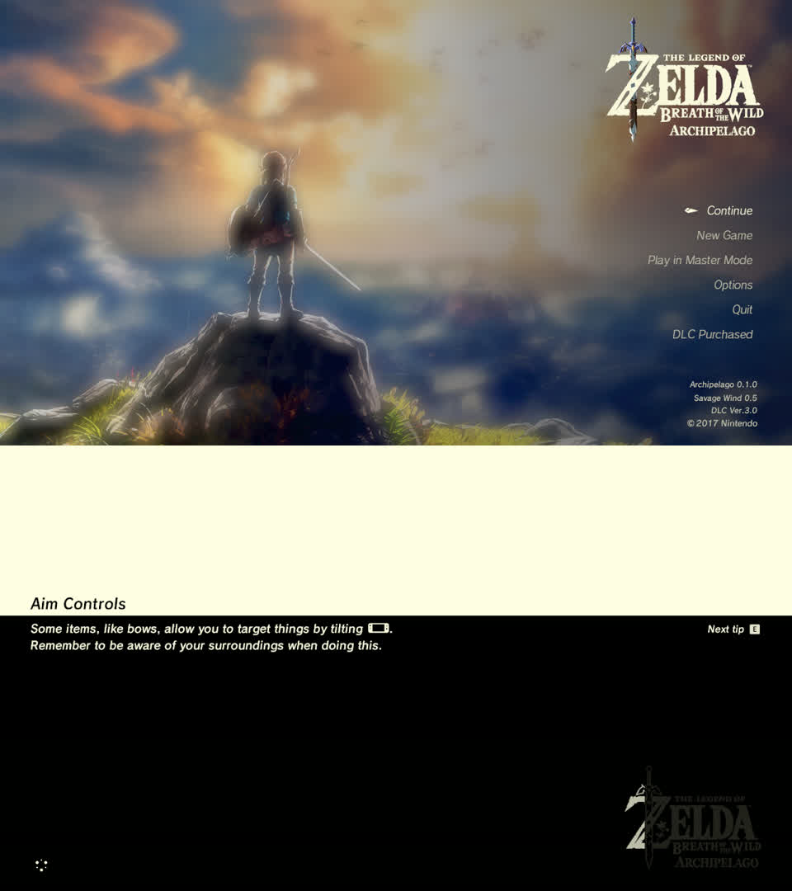
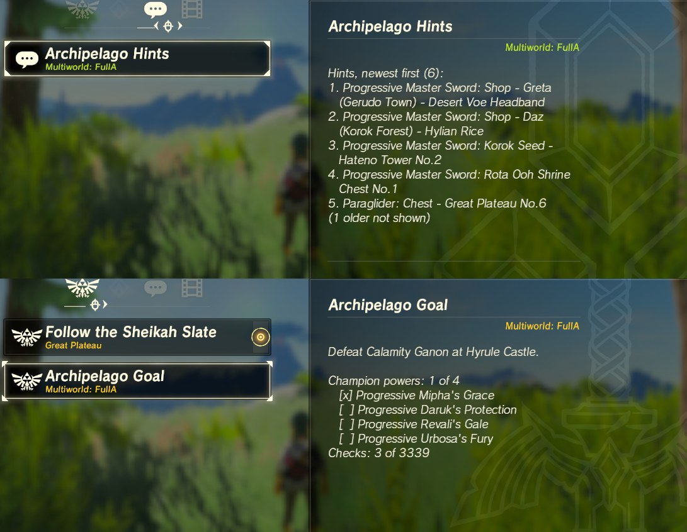
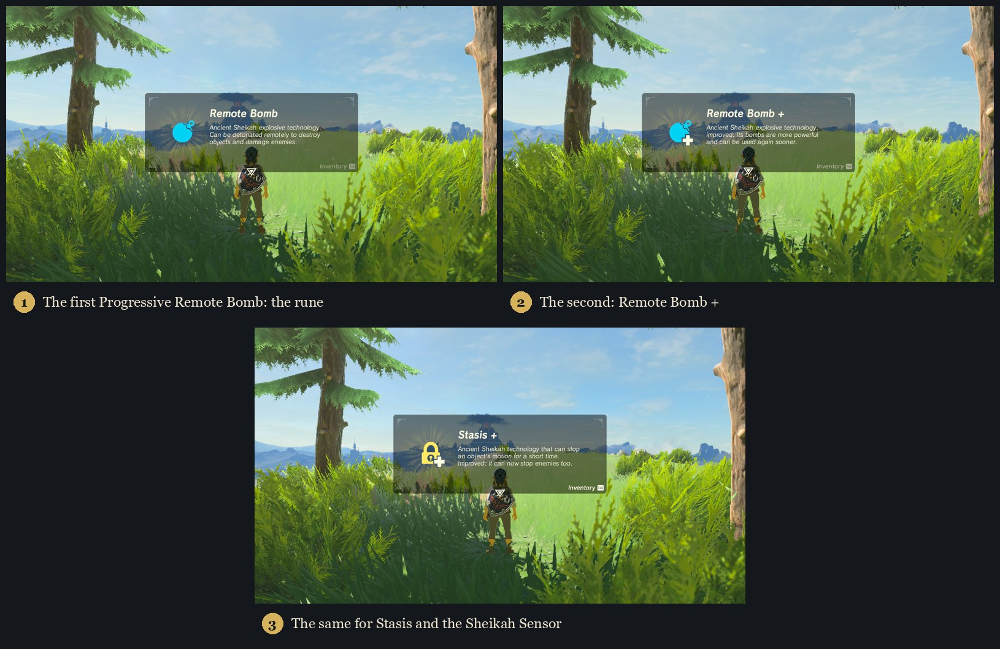
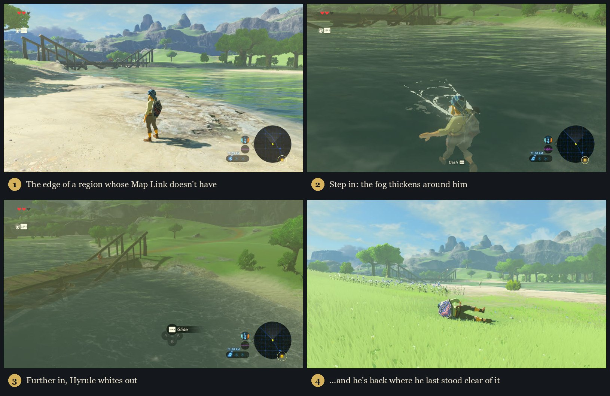
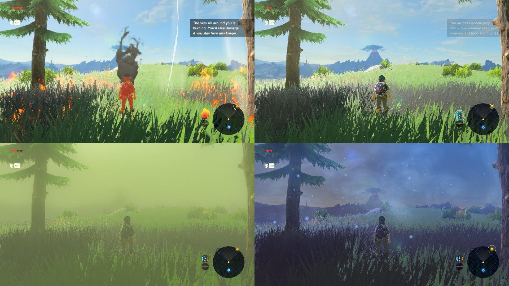
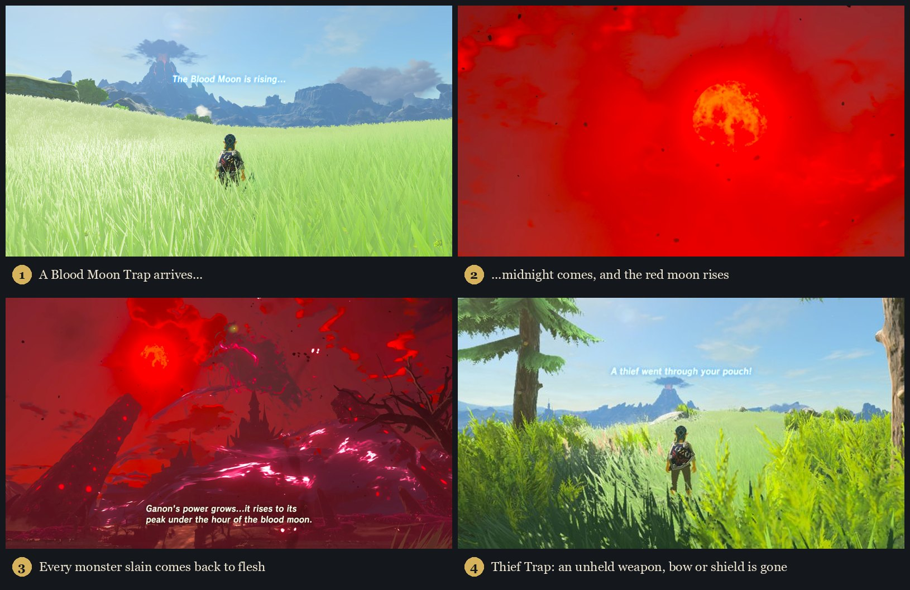
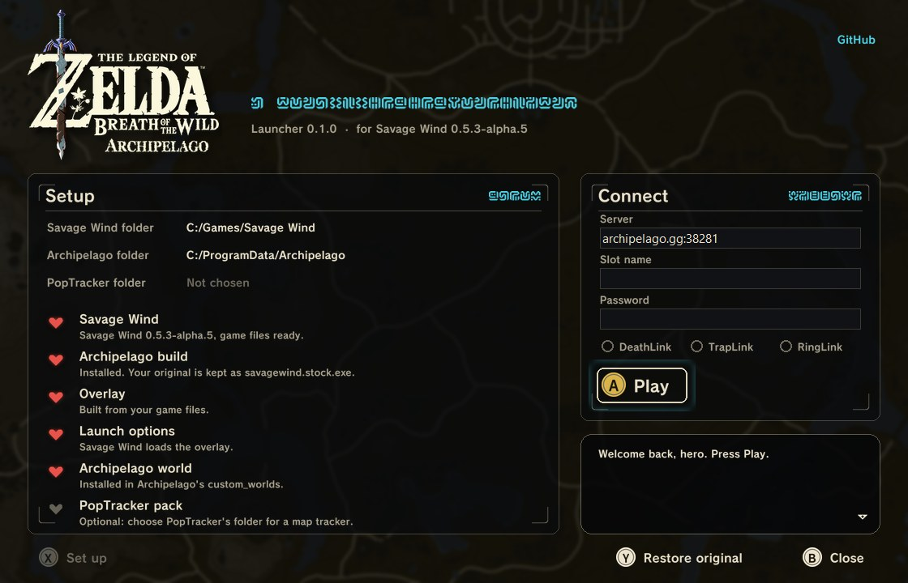

<div align="center">

# Breath of the Wild &times; Archipelago

**A multiworld randomizer for _The Legend of Zelda: Breath of the Wild_, running natively on the
[Savage Wind](https://github.com/Revivedx/SavageWindRecomp) PC recompilation.**




</div>

Shrines, Korok Seeds, chests, towers, memories, quests, Divine Beasts and shops all become checks, and nothing you
find is the game's own reward. What other players send you arrives **at once, with the game's own item-get scene**,
wherever Link is. The whole Archipelago client is built into the game: no extra client window, and a launcher
sets everything up for you.

---

## Contents
- [Features](#features)
- [What you need](#what-you-need)
- [Install with the launcher](#install-with-the-launcher)
- [Install by hand](#install-by-hand)
- [Play](#play)
- [Options](#options)
- [PopTracker](#poptracker)
- [Building from source](#building-from-source)
- [Notes](#notes)

---

## Features

### Native item delivery
Progression items play the game's own item-get scene the moment they arrive: in the field, in shrines, in Divine
Beasts. Heart Containers play their gauge scene. Filler and useful items arrive quietly, told in the chat box. Every check gives the **Archipelago Item** instead of
its normal reward, and it leaves the pouch on its own right after.


### Chat
What the room says shows at the bottom left, in the game's own font: your items, your friends' checks, chat, hints.
Press **Enter** out in the world to open the chat: scroll the log with the mouse wheel or PgUp / PgDn, type to
talk to everyone, or ask for a hint with `!hint <item>`. **Esc** closes it.

### The multiworld in your Adventure Log
Two quests of the game's own start once you connect, at **Multiworld: _your slot_**. **Archipelago Goal** (Main
Quests) shows what your goal needs and how far along you are: champion powers ticked off as they arrive, the Master
Sword if it's needed, and your checks. **Archipelago Hints** (Side Quests) lists every hint about your items and your
world, newest first, the moment it's found or bought.



### Progressive runes and champions
Remote Bomb, Stasis and the Sheikah Sensor come in two steps (the second is the **+**), Magnesis and Cryonis in
one. The four champion abilities are progressive too, with the Champions' Ballad **+**. The Great Plateau's rune
terminals and Purah's upgrades are checks of their own.



### Shop sanity
About 500 shop slots across Hyrule: town stores, armor shops, traveling merchants, Beedle at every stable, Kilton,
the tech labs. Each slot sells an **Archipelago Item** at the price of what it replaces; buy it and its check goes
out, and the shop sells its own good again.


### Region lock
Hyrule opens region by region from the Great Plateau, one Sheikah Tower region per **Map** item. Walk into a region
whose Map you don't have and the fog thickens, then everything whites out and Link is back where he last stood clear
of it, like the Lost Woods.



### Traps that change Hyrule
Traps are announced by the game's own banner. A **Fog** or **Darkness Trap** changes all of Hyrule's
light for two minutes; **Heat** and **Cold** make the air scorching or freezing for one (dress for it); a
**Fire Trap** sets the air itself alight. Then there's weather (Thunderstorm, Blizzard, Downpour, Midnight), the
game's own bans (No Warping, No Saving, Hunger), Ouch, Rupee Drain and Warp.



### Blood Moons and thieves
A **Blood Moon Trap** is the game's own Blood Moon: the clock runs to midnight, the red moon rises, and every monster
you've slain comes back. A **Thief Trap** goes through your pouch and takes a weapon, bow or shield you aren't holding.



### Everything that was vanilla is in the pool
The Paraglider (you leave the plateau when it arrives), the Thunder Helm, Hestu's Maracas, the
**Progressive Master Sword** (4 with the DLC: the sword, then each Trial of the Sword's power), Hestu's Weapon / Bow /
Shield Slots, the minigame prizes, horse gear and more.


**Also:** DeathLink, TrapLink, RingLink, and "ARCHIPELAGO" under the logo
on the title and loading screens.

---

## What you need

| | |
|---|---|
| **Game** | Your own dump of *Breath of the Wild* **1.9.0** for Switch (the Champions' Ballad is optional) |
| **Savage Wind Recomp** | The normal release (**0.6.0-alpha.6** or newer), with your game files set up in it. Each new Savage Wind release gets its Archipelago build automatically, usually within a day |
| **Archipelago** | **0.6.8** or later, to generate seeds and host |
| **Python** | Only to install by hand: 3.12 with `oead`, `evfl` and `Pillow` |

> [!IMPORTANT]
> This repository contains **no Nintendo files**. The overlay (changed game files) and the PopTracker pack are built
> on your machine from your own dump. They are yours alone: never share them.

---

## Install with the launcher



The launcher is the Sheikah Slate's map: every setup step is a landmark where it really is in Hyrule. Click one to
see its step.

1. Download **`BotW.AP.Launcher.exe`** from the [latest release](../../releases/latest).
2. Start it, click **Vah Ruta** and choose your **Savage Wind folder** (the one with `savagewind.exe`). Click the
   **Master Sword** to choose your **Archipelago** and **PopTracker** folders too, if you want the world and a map
   tracker installed.
3. Press **Set up**. The map flies to each Divine Beast in turn, and it fills with Sheikah blue while its part runs:
   - **Vah Rudania** puts the Archipelago build of Savage Wind in place (your original stays as `savagewind.stock.exe`),
   - **Vah Medoh** builds the overlay from your own game files (a minute or two),
   - **Vah Naboris** turns it on in `launch-flags.txt`,
   - the **Master Sword** installs `botw.apworld` into Archipelago and, if you chose PopTracker, a tracker pack made
     from your game files.
4. When all four beasts are free, the **Shrine of Resurrection** lights up. Fill in the server, slot name
   and password, pick your links and press **Play**.

### Updating Savage Wind

When Savage Wind has a new release, **Vah Ruta** says so: click it and press **Update Savage Wind**. The launcher
first gets the Archipelago build for the new version (a [GitHub workflow](.github/workflows/savagewind-ap.yml)
builds one for every Savage Wind release from Savage Wind's own source and this repository's patch), then runs
Savage Wind's own updater (checked and signed, undone if anything goes wrong). Savage Wind then opens its
Configuration window and builds the new version's game code from your files: close it when it's done, and the
launcher puts the Archipelago build of the new version in place. If the Archipelago build of a new version isn't out
yet, Savage Wind is left as it is.

To undo it, click Vah Rudania and **Restore the original Savage Wind**: your own `savagewind.exe` comes back and the
overlay is turned off. The launcher contains no game files: its look (BotW's font, logo, map and the Divine Beasts'
map icons) is read from your own dump when it opens.

---

## Install by hand

1. **Savage Wind with the patch.** In a [Savage Wind](https://github.com/Revivedx/SavageWindRecomp) checkout at the
   tag of the release you play (made against `v0.6.0-alpha.6`; `--3way` carries it to newer ones), from an MSYS2
   UCRT64 shell (Savage Wind's own build tools, plus `pacman -S mingw-w64-ucrt-x86_64-nlohmann-json` for the client):
   ```sh
   git apply --3way savagewind-archipelago.patch
   make -j8 B=build/ap RELEASE=1 PGO=use LTO=thin build/ap/savagewind.exe
   ```
   and put `build/ap/savagewind.exe` over the one in your Savage Wind folder (keep the original). `RELEASE=1`, PGO
   and ThinLTO are how Savage Wind's own release is built: no console window, and the release's speed.

2. **The apworld.** Copy [`botw.apworld`](botw.apworld) into Archipelago's `custom_worlds` folder.

3. **The overlay**, built once from your own game files:
   ```sh
   python -m venv .venv
   .venv/Scripts/python -m pip install oead evfl Pillow
   python -I tools/build_overlay.py "<your Savage Wind folder>"
   ```
   and add this line to `launch-flags.txt` next to `savagewind.exe`:
   ```
   SAVAGEWIND_ROMFS_OVERLAY=<your Savage Wind folder>/ap_overlay
   ```

---

## Play

1. Generate a seed with a YAML for **Breath of the Wild** (see [Options](#options)) and host it.
2. Start a **new game**.
3. **Options &rsaquo; Archipelago** (title screen, or pause menu &rsaquo; System &rsaquo; Options): enter the server,
   slot name and password, turn on the links you want, and press **Connect**.
4. Play. Checks go out the moment they happen; items arrive with their scenes. **Enter** opens the chat.

The full guide is in [`worlds/botw/docs/setup_en.md`](worlds/botw/docs/setup_en.md).

---

## Options

| Option | Default | What it does |
|---|:---:|---|
| `required_champion_powers` | 4 | Champion abilities needed for defeating Calamity Ganon to count as your goal |
| `goal_needs_master_sword` | off | The goal also needs the Master Sword |
| `master_sword_hearts` | 10 | Heart Containers logic expects before pulling the Master Sword |
| `koroks` | on | The 900 Korok Seeds are checks |
| `chests` | on | Overworld chests are checks |
| `shrine_chests` | on | Chests inside shrines are checks |
| `divine_beast_chests` | on | Chests inside the Divine Beasts are checks |
| `towers` | on | Activating each Sheikah Tower is a check |
| `memories` | on | Each captured memory is a check |
| `quests` | on | Main, shrine and side quests are checks |
| `minigames` | off | Races, archery, Snowling bowling... are checks |
| `hestu` | on | Hestu's 35 pouch upgrades and his gift are checks (slots become items) |
| `dlc` | off | Champions' Ballad checks, the champions' **+** and 4 Master Swords (needs DLC 2) |
| `master_mode` | off | The 117 chests that only exist in Master Mode are checks |
| `shop_sanity` | off | Every shop slot in Hyrule is a check (about 500) |
| `region_lock` | off | Hyrule opens region by region with 14 Map items |
| `trap_percentage` | 5 | Share of filler that is a trap |

With the defaults a seed has **2,648** checks; with everything on, **3,339**.

```yaml
name: Link
game: Breath of the Wild
Breath of the Wild:
  dlc: true
  shop_sanity: true
  region_lock: true
```

---

## PopTracker


`tools/poptracker.py` builds a [PopTracker](https://github.com/black-sliver/PopTracker) pack from your own game files:
the game's Hyrule map with the regions drawn on it and every check where it is (quests where whoever gives them
stands, memories, minigames, Hestu, each Divine Beast with its chests), a Regions panel that is Hyrule in pieces,
in colour once you have a region's Map (click one and the map zooms onto it), the world's logic, and Archipelago
autotracking of your items, checks and options.

```sh
.venv/Scripts/python -I tools/poptracker.py "<your Savage Wind folder>/extracted" poptracker
```

Put `poptracker/BotW_AP.zip` in PopTracker's `packs` folder and connect with the **AP** button.

---

## Building from source

| Path | What it is |
|---|---|
| [`worlds/botw/`](worlds/botw) | The Archipelago world: items, options, logic, location data |
| [`tools/`](tools) | Builds the location data and the overlay from your own game files, and the PopTracker pack |
| [`savagewind-archipelago.patch`](savagewind-archipelago.patch) | Savage Wind changes: the built-in client, item scenes, shops, region lock |
| [`.github/workflows/savagewind-ap.yml`](.github/workflows/savagewind-ap.yml) | Builds the patched `savagewind.exe` for every new Savage Wind release, for the launcher's update |
| [`launcher/`](launcher) | The launcher: setup logic, its window, and the PyInstaller build |
| [`build.py`](build.py) | Zips `worlds/botw` into `botw.apworld` |

```sh
.venv/Scripts/python -I tools/extract.py "<your Savage Wind folder>/extracted"   # location data
python build.py                                                                  # botw.apworld
```

To build the launcher, put your patched `savagewind.exe` (with a `savagewind.exe.sha256` holding its SHA-256) and
`botw.apworld` in `launcher/payload`, then:

```sh
.venv/Scripts/python -m pip install pyinstaller
.venv/Scripts/python launcher/build_launcher.py                                 # dist/BotW AP Launcher.exe
```

---

## Notes

- Logic is open-world, like the game: off the Great Plateau you need the Paraglider and the four runes; each plateau
  shrine needs its own rune.
- What waits on a Divine Beast in the game waits on it in logic too: the Champions' Ballad on all four, Dagah Keek and
  Zora's Domain's quests on Vah Ruta, Rito Village's on Vah Medoh, and so on. Zora Armor is needed for the waterfalls
  (Dagah Keek, Mah Eliya, Diving is Beauty!), and the Master Sword needs at least 10 Heart Containers, as in the game.
- Three chests nobody can open (Hateno Village's in front of the inn, Rassla Lake's, Aris Beach's in the sea) are never
  checks.
- This is a fan project, not affiliated with or endorsed by Nintendo. *The Legend of Zelda* is a trademark of Nintendo.

<div align="center">

Made with [Archipelago](https://archipelago.gg) &middot; MIT License

</div>
